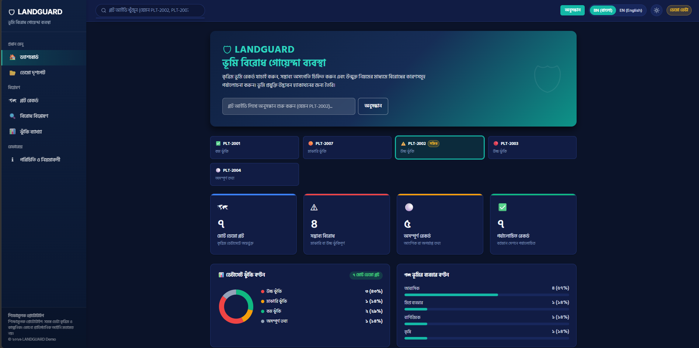
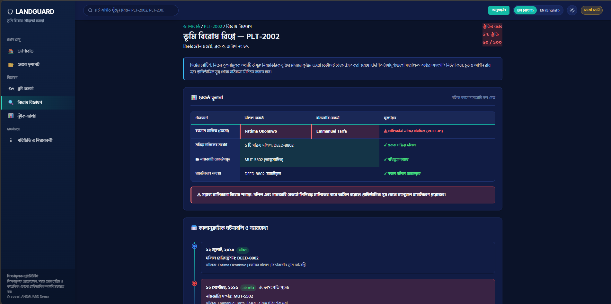
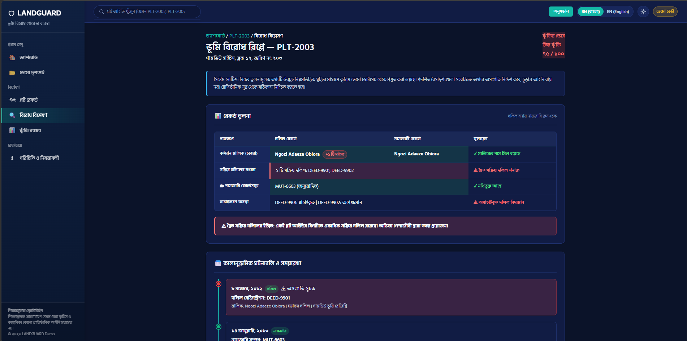
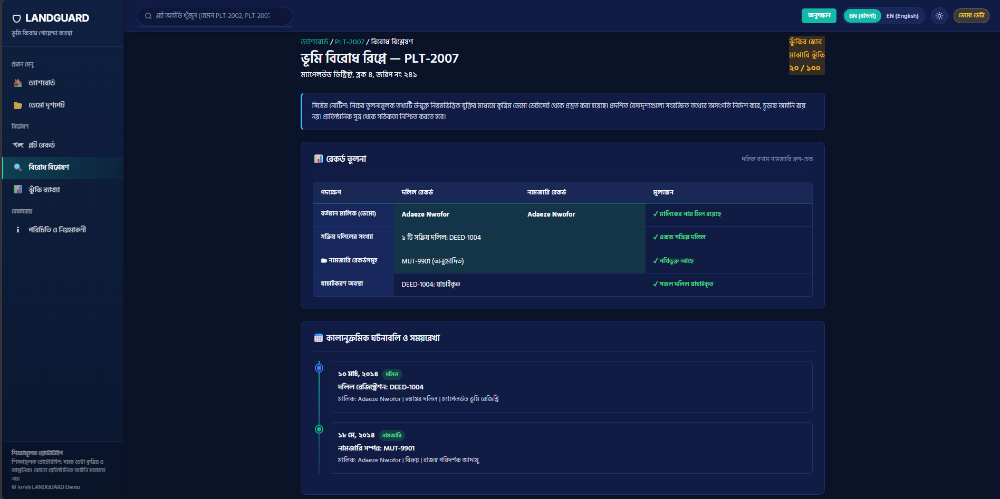
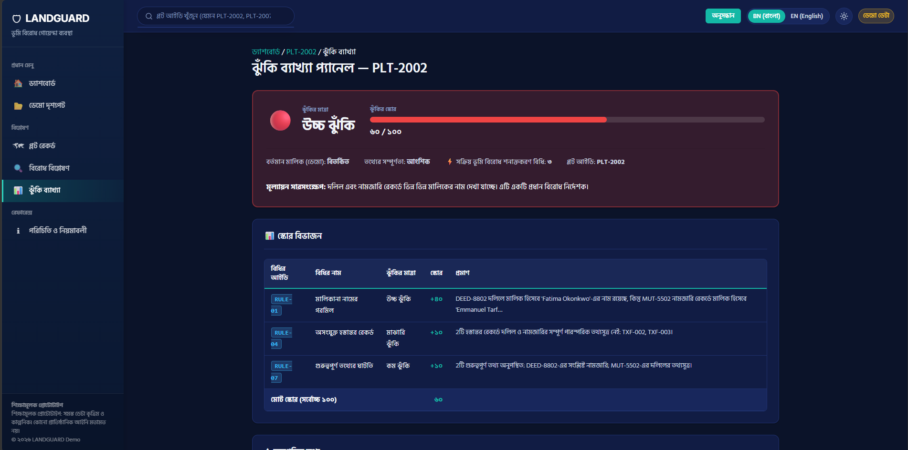
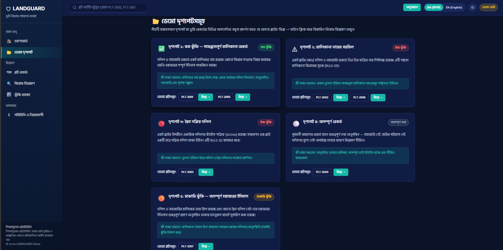

# LANDGUARD — Land Conflict Intelligence System

> **⚠ Educational Prototype — Synthetic Demo Data Only**
> LANDGUARD uses entirely fictional data and is not an official land-record verification service,
> legal opinion, or proof of fraud. All names, IDs, and records are invented for demonstration.

---

## Table of Contents

1. [Project Overview](#project-overview)
2. [Problem & Solution](#problem--solution)
3. [Features](#features)
4. [Screenshots](#screenshots)
5. [Technology Stack](#technology-stack)
6. [Project Structure](#project-structure)
7. [Installation & Running](#installation--running)
8. [Demo Scenarios](#demo-scenarios)
9. [Rule-Based Risk Scoring](#rule-based-risk-scoring)
10. [Synthetic Data Disclaimer](#synthetic-data-disclaimer)
11. [Limitations & Future Improvements](#limitations--future-improvements)
12. [AI Assistance Disclosure](#ai-assistance-disclosure)

---

## Project Overview

**LANDGUARD** is a single-page web application prototype that simulates a Land Conflict Intelligence System. Users can browse synthetic demo land records, run conflict detection analysis on them, and understand potential inconsistencies through transparent, rule-based checks and a clear risk explanation panel.

Built for the **Land Technology Innovation Hackathon**, October 2026.

---

## Problem & Solution

### Problem

Land ownership inconsistencies — mismatched owner names across deed and mutation records, duplicate active deeds, missing mutation records, and incomplete historical data — are difficult to spot without systematically comparing multiple record types. Prospective buyers and professionals need a clear way to understand what conflict indicators look like and what action they require.

### Solution

LANDGUARD demonstrates:
- How different types of land record conflicts can be detected through structured, rule-based comparison
- How risk indicators can be explained in plain language without making unfounded legal claims
- How a chronological conflict timeline can help users understand the sequence of events
- How a transparent scoring system can be fully documented and reproducible

---

## Features

| Feature | Status |
|---|---|
| **Clean English Interface & Typography** (Inter font with robust fallbacks) | ✅ Complete |
| **Light & Dark Theme Toggle** (System preference detection + localStorage persistence) | ✅ Complete |
| **Dashboard with Live Animated Counters** & SVG Data Charts | ✅ Complete |
| **Dataset Risk Distribution SVG Donut Chart** (Low, Medium, High Risk dynamic breakdown) | ✅ Complete |
| **Land Classification Bar Chart** (Dynamic land-use breakdown) | ✅ Complete |
| **Quick Scenario Switcher Strip** (1-click replay test cases) | ✅ Complete |
| **Plot Search by ID** (with live suggestions & empty states) | ✅ Complete |
| **Plot Detail View** (Deed, Mutation, Transfer records, completeness badges) | ✅ Complete |
| **Land Conflict Replay** (Side-by-side Deed vs Mutation comparison bridge) | ✅ Complete |
| **Conflict Badges & Trigger Explanations** (Plain-language, responsible wording) | ✅ Complete |
| **Chronological Event Timeline** (Progressive visual chain) | ✅ Complete |
| **Ownership Relationship Graph** (SVG visual ownership node chain) | ✅ Complete |
| **Transparent Rule-Based Risk Engine** (7 distinct deterministic rules, capped at 100) | ✅ Complete |
| **Risk Explanation Panel** (Score gauge + tabular mathematical breakdown) | ✅ Complete |
| **Actionable Next Steps** (Specific verification advice per triggered rule) | ✅ Complete |
| **Next Scenario Cycle Button** (Seamless reviewer walkthrough) | ✅ Complete |
| **5 Demo Scenarios / 7 Synthetic Plots** (Low, Medium, High Mismatch, Duplicate, Incomplete) | ✅ Complete |
| **Responsible Use Disclaimers** (Never claims legal fraud; educational scope) | ✅ Complete |
| **Responsive Mobile Layout & Navigation Drawer** | ✅ Complete |
| **Keyboard Accessibility & Reduced Motion Support** | ✅ Complete |
| **Zero External Dependencies / Paid APIs** | ✅ Complete |

---

## Screenshots

### Main Dashboard


### Conflict Replay - PLT-2002


### Conflict Replay - PLT-2003


### Conflict Replay - PLT-2007


### Risk Explanation Panel


### Demo Scenarios


## Technology Stack

| Component | Technology |
|---|---|
| Markup | HTML5 (Semantic landmarks, ARIA live regions, roles) |
| Styling | Modern CSS3 (Custom properties/design tokens, CSS Grid, Flexbox, media queries) |
| Fonts | Web font `Inter` (English primary UI) with system fallbacks |
| Themes | CSS variables with `data-theme="light|dark"`, Sun/Moon SVGs |
| Internationalization | `I18n` engine (`js/i18n.js`) with English date formatting and ASCII numbers |
| Logic | Vanilla JavaScript ES6+ (No external build tools or heavy frameworks) |
| Analytics | Lightweight inline SVG charts (Donut chart & Bar chart, zero dependencies) |
| Data | Synthetic JavaScript dataset (`data/demo-data.js`) |
| Backend | None required — 100% transparent client-side evaluation |
| Server | Node.js `npx serve` or Python `http.server` |

---

## Project Structure

```
Landtech Hackathon/
│
├── index.html                  ← Main application HTML (Semantic, accessible, themed)
│
├── css/
│   └── styles.css              ← Design system, tokens, light/dark themes, responsive layout
│
├── js/
│   ├── i18n.js                 ← Localization engine & English formatting helpers
│   ├── theme.js                ← Light/dark mode controller with localStorage persistence
│   ├── risk-engine.js          ← Transparent 7-rule scoring engine
│   └── app.js                  ← Main UI controller, SVG visualizers, event routing
│
├── data/
│   └── demo-data.js            ← 7 synthetic demo plots with comprehensive land records
│
├── test/
│   ├── structure-check.js      ← Structural integrity & asset verification
│   ├── validate.js             ← Automated logic validation tests (10/10 passed)
│   ├── e2e-audit.js            ← End-to-end interactive audit suite (64/64 passed)
│   └── browser-test.js         ← Headless browser DOM rendering verification
│
├── submission/
│   ├── concept-note.md         ← Hackathon concept note (≤4 pages)
│   ├── demo-video-script.md    ← Timed demo video script (≤3 min)
│   └── final-submission-checklist.md  ← Pre-submission checklist
│
├── screenshots/                ← Demo screenshots folder
│
├── README.md                   ← Project documentation
└── .gitignore
```

---

## Installation & Running

### Prerequisites

You need **one** of the following:
- **Node.js** (recommended) — check with `node --version`
- **Python** (optional) — check with `python --version` or `python3 --version`
- **VS Code** with the Live Server extension

### Option A — Node.js (npx serve) — Verified Working

```bash
cd "d:\Landtech Hackathon"
npx serve . -l 8080 --no-clipboard
# Then open in browser: http://localhost:8080
```

### Option B — Python (if installed)

```bash
cd "d:\Landtech Hackathon"
python -m http.server 8080
# Then open in browser: http://localhost:8080
```

### Option C — VS Code Live Server

1. Open the `Landtech Hackathon` folder in VS Code
2. Install the **Live Server** extension (by Ritwick Dey) if not already installed
3. Right-click `index.html` in the Explorer
4. Click **"Open with Live Server"**
5. Browser opens automatically at `http://127.0.0.1:5500`

### Option D — Direct File Open (Quick Test)

Double-click `index.html`. **Note:** Some browsers restrict local file access for security. If features don't load, use one of the server options above.

### Running Automated Tests

You can execute the built-in automated test suites at any time:

```bash
# 1. Structural integrity verification
node test/structure-check.js

# 2. Rule & logic validation suite (10/10 passed)
node test/validate.js

# 3. Comprehensive end-to-end audit (64/64 passed)
node test/e2e-audit.js

# 4. Headless browser DOM rendering verification (against running server)
node test/browser-test.js
```

---

## Demo Scenarios

All scenarios are ready to run — no code editing required.

### How to access scenarios

1. Open the application
2. Click **"Demo Scenarios"** in the left sidebar, or click the **"Explore Demo Scenarios"** button on the dashboard

### Scenario 1 — Consistent Records (PLT-2001, PLT-2005)

**What to expect:** No conflict rules are triggered. Deed and mutation records agree on the owner. Transfer history is chronologically clean. Risk level: **No Conflict Detected**.

**How to run:**
1. Go to Demo Scenarios → Scenario 1
2. Click **PLT-2001** → View → Conflict Replay
3. Observe: comparison table shows ✓ matches; no rules triggered; all-clear message

### Scenario 2 — Ownership Mismatch (PLT-2002, PLT-2006)

**What to expect:** The deed lists one owner name; the mutation lists a different name. **RULE-01** is triggered. Risk level: **High**.

**How to run:**
1. Go to Demo Scenarios → Scenario 2
2. Click **PLT-2002** → Replay →
3. Observe: comparison table highlights the mismatched owner names in red; RULE-01 card explains the evidence

### Scenario 3 — Duplicate Active Deeds (PLT-2003)

**What to expect:** Two deeds with Active status exist for the same plot. **RULE-02** is triggered (and RULE-04, RULE-05 may also trigger). Risk level: **High**.

**How to run:**
1. Go to Demo Scenarios → Scenario 3
2. Click **PLT-2003** → Replay →
3. Observe: both active deeds shown; duplicate warning displayed; timeline shows two separate deed registration events

### Scenario 4 — Incomplete Records (PLT-2004)

**What to expect:** Legacy record with missing area, no mutation, no consideration amount. **RULE-03** and **RULE-07** triggered. Risk level: **Incomplete Data**.

**How to run:**
1. Go to Demo Scenarios → Scenario 4
2. Click **PLT-2004** → Replay →
3. Observe: missing fields listed; limited timeline; incomplete data badge

### Scenario 5 — Medium Risk: Incomplete Ownership History (PLT-2007)

**What to expect:** The recorded deed owner and mutation owner match (Adaeze Nwofor), and there is a single active deed (DEED-1004). However, an intermediate internal transfer (TXF-011) lacks supporting deed and mutation references. **RULE-04** and **RULE-07** are triggered. Risk level: **Medium Risk** (Score: 20).

**How to run:**
1. Go to Demo Scenarios → Scenario 5
2. Click **PLT-2007** → Replay →
3. Observe: Deed and mutation owners match, single active deed verified, but missing historical chain documentation flags Medium Risk.

---

## Rule-Based Risk Scoring

The scoring system is fully transparent and reproducible. There is no AI or machine learning involved.

### Rules

| Rule | Name | Severity | Points | Trigger Condition |
|---|---|---|---|---|
| RULE-01 | Ownership Mismatch | HIGH | +40 | Deed owner ≠ mutation owner (case-insensitive, normalised) |
| RULE-02 | Duplicate Active Deeds | HIGH | +45 | ≥ 2 deeds with status "Active" for same plot |
| RULE-03 | Missing Mutation Record | MEDIUM | +15 | Plot has deeds but zero mutation records |
| RULE-04 | Unlinked Transfer Record | MEDIUM | +10 | Transfer history entry missing deed or mutation reference |
| RULE-05 | Unverified Deed | MEDIUM | +10 | Any deed has verificationStatus ≠ "Verified" |
| RULE-06 | Chronological Inconsistency | HIGH | +20 | Transfer date precedes referenced deed registration date |
| RULE-07 | Missing Critical Fields | LOW | +5/field, max +20 | missingFields array is non-empty |

### Risk Level Thresholds

| Score | Risk Level |
|---|---|
| 0 | No Conflict Detected |
| 1–19 | Low |
| 20–49 | Medium |
| 50–100 | High |
| Mostly RULE-07 only | Incomplete Data |

Score is capped at 100. The full logic is in [`js/risk-engine.js`](js/risk-engine.js).

---

## Synthetic Data Disclaimer

**All data in LANDGUARD is entirely fictional.**

- Plot IDs, deed IDs, and mutation IDs are invented identifiers.
- All owner names are fictitious persons — not real individuals.
- Locations, dates, consideration amounts, and office names are invented.
- The data does not represent any real land parcel, transaction, or record.
- No government database, portal, or API is accessed by this application.
- The system provides preliminary screening and educational intelligence only, not a legal opinion or guarantee of legal ownership.

The full dataset is in [`data/demo-data.js`](data/demo-data.js) and can be inspected or extended freely.

---

## Limitations & Future Improvements

### Current Limitations

- Seven demo plots in the synthetic dataset (PLT-2001 to PLT-2007)
- No backend or database — records cannot be added via the UI
- No PDF export for conflict reports
- Ownership graph is simple — does not support complex branching lineages
- Not tested with assistive technologies beyond keyboard navigation

### Future Improvements

- Connection to authorised public land APIs (where legally available)
- Expanded rule set developed with legal and land admin experts
- Multi-jurisdictional registry rule configuration
- PDF export of conflict summary and audit reports
- Persistent backend (database) for institutional use
- Formal WCAG 2.1 AA accessibility audit

---

## AI Assistance Disclosure

This project was developed with the assistance of AI tools:

- **Antigravity AI (Google DeepMind)** was used as a pair-programming coding assistant to help architect modular vanilla JavaScript components, formulate rule-based land verification algorithms, debug responsive styling and dark mode contrast tokens, and construct automated validation and browser-audit test suites.
- All logic, deterministic scoring rules, synthetic data schema, and legal disclaimers were reviewed, tested, and validated.
- The application does not rely on opaque or non-deterministic AI generation at runtime; all risk scoring is 100% deterministic, rule-based, and reproducible in client-side code.

---

*LANDGUARD — Built for the Land Technology Innovation Hackathon, October 2026.*
=======
# LANDGUARD
Land Conflict Intelligence System - LandTech 2026

